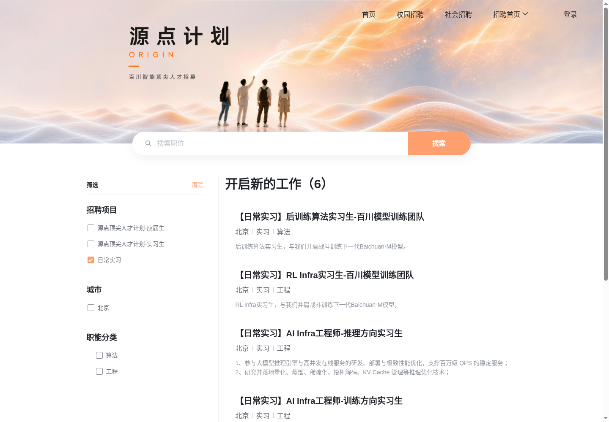

# 企业官网实习岗位聚合平台 · 活动提交材料

使用 Lexmount WebFetch 与 Cloud Browser 处理企业官网及动态招聘系统，建立统一检索的岗位库。完整作品说明、运行过程、数据依据和结果均可在本仓库查看。

- [在线材料与结果演示](https://tlevif.github.io/lexmount-internship-submission/)
- [下载完整提交包（ZIP）](https://raw.githubusercontent.com/Tlevif/lexmount-internship-submission/main/submission.zip)
- [作品说明（文字版）](materials/REPORT.md)
- [作品说明（PDF）](materials/REPORT.pdf)
- [活动表单填写文案](materials/FORM_TEXT.md)
- [完整5,213条结果（CSV）](materials/results/jobs.csv)
- [运行证据目录](materials/evidence/)
- [数据口径与数量](materials/SUMMARY.json)
- [文件哈希清单](materials/MANIFEST.json)

当前结果包含5,213条去重岗位，来自35家企业；目录89家，其中51家完成岗位核验、7家完成入口核验、31家待验证。岗位总数包含技术和业务方向，补齐详情后当前规则下52条待审核。原始批量采集为2026-10-22至23日，2026-10-27补充百川6岗云端复核、原292条待审核岗位详情补采和软件验收（69项测试通过）。

Lexmount Cloud Browser 实际运行截图：

解压提交包后，可用 `python verify_package.py` 核验文件哈希与5,213条岗位唯一性。配套最小源码包的运行方法见包内 RUN.md。

## 跨主机访问验收

[独立云主机匿名验收已通过](https://github.com/Tlevif/lexmount-internship-submission/actions/runs/40495502588)：材料页、PDF、完整结果和ZIP均可访问，结果计数5,213条；详情补采版本ZIP内317个文件全部通过SHA256校验，待审核52条与补齐262条也通过核验。[验收明细](ACCESS_VERIFICATION.json)。

详情补采结果：262条岗位补齐缺失字段，共补211条职责、262条要求；剩余2条明确标注下线/未检索到。证据见 [详情补采统计](materials/evidence/detail-enrichment/SUMMARY.json)。
